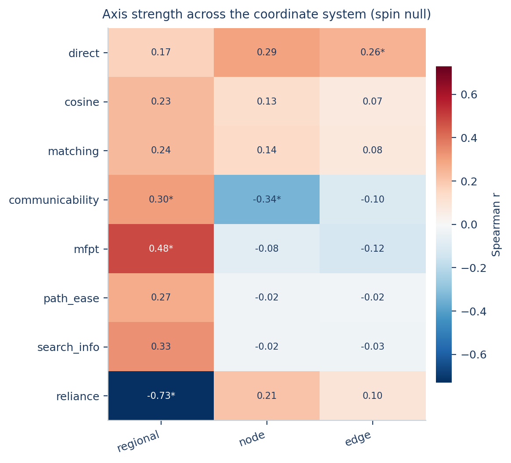

# SFCX — structure–function coupling explorer

**[中文](README.md) | [English](README_EN.md)**

一个把「读数坐标系」变成可执行代码的小工具箱。

同一批被试、同一套数据，只要换一个耦合定义、换一种离散度估计量、或换一个观察尺度，
"连接轴"的方向和强度就会改变——这不是数据不稳定，而是**坐标没绑定**。
SFCX 把这四个层写进 API，让每一次结论都能定位到它的坐标上。

```
定义（definition）   →  哪种结构—功能对应
流程（pipeline）     →  哪种功能表征
估计量（estimator）  →  对什么取离散度
尺度（scale）        →  在哪个粒度上汇总
```

两个运行时（Python / MATLAB）按同一份定义实现，27 个耦合定义、逐被试耦合值导出、
变异分析、批量导入一应俱全；MATLAB 端有跨运行时数值对照测试。

---

## 在线演示

无需安装，浏览器直接打开即可操作（每访客独立会话，公开模式不支持自定义耦合函数）：

> **在线实例**：<https://sfcx-coupling.app.workbuddy.host/?sharecode=K2NICIDQEM>
> （演示实例随时可能更换或停用，长期使用请本地部署。）上传的会话数据存放在云端沙箱，服务重启后清空——**请不要上传敏感数据**。

## 仓库结构

```
sfcx/                  Python 包（分析引擎、Web 服务、前端单页）
  web/index.html       网页界面（零依赖，标准库 http.server 驱动）
matlab/+sfcx/          MATLAB 工具箱（同一套定义 + uifigure App）
  tests/               数值对照测试（run_tests.m / run_gui_tests.m）
examples/              5 被试教学数据集 + quickstart 脚本
tests/                 Python 冒烟测试（pytest 可选，selftest.py 无依赖）
docs/                  论文方法段落草稿、真实数据接入说明
启动Web界面.bat / SFCX网页版-启动.vbs   本地网页版启动器
启动MATLAB界面.bat                      MATLAB App 启动器
```

---


## 双击即用（两个版本）

文件夹根目录有四个启动器，**双击即可，全程不需要命令行**：

| 启动器 | 行为 | 备注 |
|---|---|---|
| `SFCX网页版-启动.vbs` | **推荐**。后台静默启动服务并自动打开浏览器，**不显示任何黑窗口**；若服务已在运行则直接打开浏览器 | 关闭浏览器不停止服务；要停止用下一个 |
| `SFCX网页版-停止.vbs` | 停止后台服务 | 也弹确认框 |
| `启动Web界面.bat` | 旧版控制台启动（黑窗口，关窗即停） | 喜欢看日志时用 |
| `启动MATLAB界面.bat` | MATLAB App（`sfcx.app`） | MATLAB 路径写在 bat 里，可改 |

VBS 启动器会自动挑选装有 numpy/scipy/matplotlib 的 Python（`python` → `py` → miniconda 依次探测），失败时弹窗显示日志尾部（`sfcx_web_log.txt`，位于工具箱根目录）。服务固定跑在 `127.0.0.1:8765`，仅本机可访问。

可以把 `SFCX网页版-启动.vbs` 发送到桌面快捷方式（右键 → 发送到 → 桌面快捷方式），之后桌面上双击即用。

### 在线部署（任何人用浏览器即可操作）

服务端支持公网部署：`--public` 模式下**每个访客独立会话**（cookie `sfcx_sid`，上传、结果互不可见），并**禁用自定义代码执行**；服务读取 `PORT` 环境变量并绑定 0.0.0.0，适配反向代理/沙箱环境：

```bash
pip install -r requirements.txt
PORT=3000 python -m sfcx.webapp --public
```

已发布实例：见工具箱对应的应用链接。注意公开实例上任何人都能上传数据并运行分析——**不要上传敏感/未发表数据**；会话数据存放在沙箱内，重启即清空。本地双击版与在线版功能一致（在线版多一个限制：不能粘贴自定义耦合函数）。

### 多被试批量导入（网页版）

三种等价方式，任选其一：

1. **多文件合并（推荐）**：在 SC / FC / BOLD 槽位的「选择」按钮里一次选中多个同形状文件（如 20 个 subNN.csv），或在某个槽位上一次拖入多个文件——自动逐个上传并堆叠为 N×P×P，槽位显示 "batch_N_subjects.npy · N 被试"；
2. **单个三维文件**：一个 .npy / .npz / .mat 直接含 N×P×P（或 N×P×T）数组；
3. **示例数据**：内置 demo 就是这种形式。

形状不一致会立即报错（双语），批量不足 2 个文件也会提示。MATLAB 版对应功能是批量模式的「文件夹（每人一个文件）」（`sfcx.batchStack`）。

命令行等价（可选，不用命令行可忽略）：

```bash
python -m sfcx.webapp --port 8765 --open     # 网页版
```

```matlab
addpath('...\sfcx_toolbox\matlab'); sfcx.app % MATLAB 版
```

## 安装（可选，命令行用户才需要）

```bash
cd sfcx_toolbox
pip install -e .
```

依赖：`numpy` `scipy` `matplotlib`。可选：`pandas` `scikit-learn` `pyyaml`。

## 30 秒跑通

```bash
sfcx demo --out ./sfcx_demo
```

会做四件事：生成一个合成队列 → 跑一条默认路线 → 扫一遍坐标矩阵 → 写一份自带图的 HTML 报告。
约 3 秒（400 被试 × 200 脑区）。

输出：

```
sfcx_demo/
  demo_cohort.npz
  route/
    results.json          # 全部数字
    figures/*.png         # 6 张图
    tables/*.csv
    report.html           # ← 打开这个
  sweep/
    axis_r.csv            # 定义 × 估计量的 r 矩阵
    axis_p.csv
    figures/coordinate_matrix.png
    sweep.json
```

## 5 被试教学数据集

想先拿一份「小而完整」的数据把三种入口都走一遍，用 `examples/data/`：

| 文件 | 用途 |
|---|---|
| `demo5_group.npz` | 一次导入全部（SC / FC / BOLD / 网络 / 层级 / 坐标 / 行为 / 协变量） |
| `demo5_group.mat` | 同上，MATLAB 版 |
| `sub-0X_*.csv` | 单被试矩阵，用于逐槽上传、验证格式 |
| `demo5_expected.json` | 参考结果，用来核对导入是否成功 |
| `README.md` | 字段说明、导入步骤、参考数值与数据构造逻辑 |

```bash
python examples/make_example_data.py      # 重新生成（固定种子，可复现）
python examples/verify_example_data.py    # 校验并刷新 demo5_expected.json
```

规模：5 被试 × 64 脑区 × 120 时间点，SC 密度 24.6 %。BOLD 与存储 FC 完全自洽（从 BOLD 反算 FC 的差值为 0）。
参考结果：communicability 区域级轴 r = +0.50（p = 0.002），direct 区域级 r = +0.33（p = 0.050），
reliance 区域级 r = +0.49 但边级 r = +0.01 —— 同一份数据、同一个轴，换估计量结论就变，这正是工具箱要讲的事。

## 合成队列上看到的现象

同 400 名被试、同一层级轴、同一 spin 零模型，只改坐标：

| 结果 | 数值 |
|---|---|
| 区域级轴（communicability） | r = +0.30，spin p = 0.016 |
| 控制耦合幅度后 | r = +0.34，p = 0.008（不降反升） |
| 网络内 vs 网络间 | 0.866 vs 0.351，Δ = +0.515，p = 0.002 |
| split-half | r = 0.998 |
| 焦点（本例 6 个） | 内部邻接 0，z = −1.20 |
| 个体偏差谱斜率 | 边级 r = +0.28（p = 8×10⁻⁹）；网络级 r = +0.08（p = 0.09） |
| **坐标矩阵中轴的范围** | **−0.73 到 +0.48** |

最后一行是这个工具存在的理由：**同一份数据，"轴"可以是强正、可以是强负、也可以接近零。**



## 三种入口

同一套分析引擎，三种用法：网页界面、MATLAB 工具箱、Python / 命令行。三者的耦合定义、变异估计、零模型与轴统计量按同一份定义实现，MATLAB 端另有数值对照测试。

### 1. 网页界面

```bash
sfcx web --port 8765 --open        # 等价于 python -m sfcx.webapp --port 8765 --open
```

界面按「数据 → 方法 → 运行 → 结果」四步组织：

- **数据**：把文件拖到顶部投放区，或点「选择文件」，也可拖到单个槽位。支持 `.npy/.npz/.mat/.csv/.tsv/.txt`，可一次拖入多个文件：含 `sc`/`fc`/`bold` 等键的 `.npz/.mat` 会自动填入全部对应槽位，裸矩阵按文件名与形状自动归位（方阵 → SC/FC，非方阵 → BOLD）。BOLD 会按所选流程（`pearson` / `precision`）转成 FC 边向量。注释项（网络标签、层级、球面坐标、行为、协变量）可选。
- **方法**：先用「主耦合定义」下拉选结果首屏使用的定义，再在下方勾选参与计算的定义（可多选）；另有估计量（区域级 / 节点投影 / 边级）、零模型（`auto` / `spin` / `msr` / `permutation`）、置换次数与状态名。
- **分析模式（二选一）**：
  - **变异分析**（默认）：上述全部统计，需要 **≥2 名被试**（<8 时结果仅作演示参考）；
  - **耦合值计算**：跳过所有变异统计与零模型，直接输出每个被试的耦合值——**单被试即可运行**；结果含逐指标表格与组平均矩阵热图，可下载 `coupling_values.npz` 与逐被试 CSV 打包（每指标两份：全部边、全部脑区）。
- **自定义**：粘贴函数源码，先做静态校验与小样本试算，通过后才注册。
- **结果**：连接轴表（r / p / n / 零模型）、变异剖面、网络内 vs 网络间、震中区域、定义 × 估计量的坐标扫描矩阵；可下载 CSV、PNG 与自带图的 HTML 报告。
- **语言**：右上角 `EN / 中文` 一键切换，选择会记住；后端若仍是旧进程，页面会提示重启 `python -m sfcx.webapp`。

服务端只用 Python 标准库（`http.server`），不需要 Flask/FastAPI；分析在后台线程执行，页面轮询进度。

### 2. MATLAB 工具箱

```matlab
addpath('...\sfcx_toolbox\matlab')
sfcx.app
```

`sfcx.app` 是四页签界面（① 数据导入 → ② 变异分析 → ③ 耦合值计算 → ④ 日志），支持**单被试**与**多被试批量**（文件夹每人一文件，或单个含三维数组/元胞的 .mat）两种导入模式；页签③对单被试即可计算并导出耦合值（CSV + MAT）。详见 `matlab/README.md`。

无界面调用与 Python 端同名：

```matlab
coh = sfcx.buildCohort(struct('sc', sc, 'fc', fc, 'networks', net, ...
                              'hierarchy', hier, 'coords', xyz));
b   = sfcx.analyze(coh, {'communicability', 'direct'}, ...
                   'estimators', {'regional', 'node', 'edge'}, 'nPerm', 500);
b.sweep.r          % 定义 × 估计量的轴相关系数
b.tables.axis_r    % 同一矩阵的 CSV 文本

vals = sfcx.couplingValues(coh, {'direct'});       % 单被试也行
sfcx.exportCouplingValues(vals, outdir, {'csv','mat'});
```

数值一致性由 `matlab/tests/run_tests.m` 对照 `matlab/tests/reference.mat`（Python 端生成）校验：
12 个快定义 × 3 估计量共 36 格，其中 33 格逐格对照（10 个定义 |Δr| ≤ 5e-7，reliance 容差 5e-2），
`search_info` 因最短路径选路并列不可跨运行时对照而排除。详见 `matlab/README.md`。

### 3. 命令行 / Python API

下面几节仍是这两种用法。

## 命令行

```bash
sfcx describe                          # 打印四层坐标系与预设
sfcx demo   --out DIR [--subjects 400] [--nodes 200] [--perm 500]
sfcx run    --npz cohort.npz --preset default --out DIR
sfcx run    --npz cohort.npz --metric direct --estimator edge --out DIR
sfcx sweep  --npz cohort.npz --out DIR
```

预设：`default`（区域级）、`edge-signal`（边级个体信号）、`node-contrast`（同数据换估计量）、
`precision-fingerprint`（precision 流程）。

## Python API

```python
import sfcx
from sfcx import Cohort, Coordinate

coh = Cohort.from_npz("cohort.npz")

res = sfcx.run(coh, Coordinate(metric="communicability",
                               pipeline="pearson",
                               estimator="regional",
                               scale="regional"),
               outdir="out", n_perm=1000)

print(res["axis"])          # {'r': ..., 'p': ..., 'null': 'spin'}
print(res["layers"])        # within / between / delta / p
print(res["epicentres"])    # focal regions, separation z
print(res["individual"])    # slope at four scales
```

坐标是冻结的 dataclass，写错层会立刻报错：

```python
Coordinate(estimator="regional")            # ok
Coordinate(estimator="region")              # CoordinateError: unknown estimator
Coordinate.from_preset("default").with_(scale="edge")
```

## 自定义耦合函数

两端都支持自定义定义，签名固定为 `couple(sc, fc, iu, iv, n_nodes)`：

- `sc`, `fc`：`(N, E)`，上三角展开、与 `iu/iv` 同序
- 返回 `(N, E)` / `(E,)` / `(N, P)` / `(P,)` / `(P, P)` 或标量，会自动按尺寸识别是边级还是区域级

Python：

```python
from sfcx import register_custom, dry_run, list_custom

SRC = """
def couple(sc, fc, iu, iv, n_nodes):
    return sc * fc
"""

dry_run(SRC, n_subjects=8, n_nodes=24)   # 只试算，不注册
register_custom("my_coupling", SRC)      # AST 白名单校验 + 小样本试算通过后注册
list_custom()
```

MATLAB：

```matlab
src = sprintf('function out = couple(sc, fc, iu, iv, nNodes)\n    out = sc .* fc;\nend\n');
sfcx.registerCustom('my_coupling', src, 'elementwise product');
sfcx.coupling(coh, 'my_coupling');
```

注册后的名字与内置定义完全等价，可直接进入批量分析、坐标扫描与导出。

安全边界：Python 端用 AST 白名单，禁止 `import`、文件/网络访问与下划线属性，命名空间只暴露 `np`、`zscore_edges`、`mat_to_vec`、`vec_to_mat`、`upper_tri_index`；MATLAB 端把源码写成临时 `.m`，先在小样本上试算，失败即拒绝注册。

## 数据格式

一个 `.npz`，必须包含：

| 键 | 形状 | 含义 |
|---|---|---|
| `sc` | (N, E) | 结构连接，上三角展开 |
| `fc` | (N, E) | 功能连接，同序 |
| `iu_i`, `iv_j` | (E,) | 每条边的两个端点 |
| `networks` | (P,) | 每个脑区的网络标签（Yeo-7 等） |
| `hierarchy` | (P,) | 皮层层级位置，低=单模态 |

可选：`coords` (P,3) 球面坐标（启用 spin 零模型）、`behaviour` (N,)、`covariates` (N,k)。

`E` 必须等于 `P(P-1)/2`；`P` 会从 `iu/iv` 推出。

```python
from sfcx import Cohort, demo
coh = demo.make_cohort(n_subjects=400, n_nodes=200)
demo.write_npz("demo_cohort.npz", coh)
```

### 也可以只给 BOLD 时间序列

| 形状 | 含义 |
|---|---|
| `(P, T)` | 单个被试 |
| `(N, P, T)` | 多被试 |

`pearson` 流程直接对上三角各边求相关；`precision` 流程对协方差做 Ledoit-Wolf 收缩后取偏相关。缺失值沿时间轴线性插值，2-D 输入默认按「较长的一维是时间」判断（可用 `time_axis` 覆盖）。

```python
from sfcx import build_cohort
coh = build_cohort({"bold": bold, "sc": sc, "networks": net, "hierarchy": hier},
                   fc_kind="pearson")
```

网页与 MATLAB 界面的「BOLD 序列」入口走的是同一条路径。

## 零模型：p 值的意义取决于你用哪个

| 零模型 | 需要什么 | 何时用 |
|---|---|---|
| `spin` | `coords` | 有球面坐标时的首选，保持空间自相关 |
| `msr` | 无 | Moran spectral randomisation（特征向量符号翻转近似），无坐标时的默认 |
| `permutation` | 无 | 只用于冒烟测试；**不保持空间自相关，p 偏小** |

报告页脚会写清楚本次用的是哪个。**只报 p 而不报零模型，等于没报。**

## 三条分析路线

| 路线 | 坐标 | 回答什么 |
|---|---|---|
| 地形学 | estimator=regional, scale=regional | 变异在哪里、是否沿层级、焦点在哪 |
| 个体信号 | estimator=edge, scale=edge | 偏差谱斜率是否携带行为信息、在哪个尺度读 |
| 可分离性 | estimator=node + 控制 FC | 控制 FC 变异后，SFC 残差是否仍沿层级 |

## 诚实的边界

- **只做后处理**：输入是已经算好的 SC/FC 边向量或 BOLD 时间序列，不做配准、去噪、追踪。
- **最低被试数**：变异度类统计（离散度、轴、层级、可靠性、个体信号）需要 **≥2** 名被试——单个被试没有"个体间差异"，SD 在数学上未定义；界面会直接说明并引导到耦合值模式。n < 8 时结果仅作演示参考。**耦合值计算没有这个限制**，1 名被试即可。
- **27 个定义分两档**：12 个"快"定义（矩阵类通信测度 + 直接对应 + 剖面回归）默认参与坐标扫描；
  15 个"慢"定义（hybrid 模型、Granger、传递熵、信息几何、RNC/TRR 等）完全可用，但按被试逐一计算，
  只在显式勾选时运行——`catalog()` 里的 `cost` 字段标了每一档。
- **需要 BOLD 的定义**（reliance 系列、Granger、传递熵、RNC、TRR）在没有时间序列的队列上会
  明确报错，而不是静默给出无意义数字。
- **焦点检测依赖邻接图**：结构连接越稀疏，局部极大值越多；稠密图会只剩一个全局极大。
- **`msr` 是特征向量符号翻转的近似**，不是 Wagner & Dray 的完整 MSR。
- **跨运行时数值对照**：12 个快定义中 10 个与 MATLAB 端逐格一致（|Δr| ≤ 5e-7）；
  `search_info` 因最短路径并列时两个运行时选路不同而不可逐格对照（已从对照中排除并在结果中注明）；
  `reliance` 边级读出存在 ~1e-2 量级的浮点累积差异（容差 5e-2）。
- 合成数据的目的是演示坐标依赖，**不是**模拟真实脑网络的全部统计性质。

## 与论文的关系

本工具实现论文 Methods 的四层读出与三条分析路线；`sweep` 对应"轴方向随估计量翻转"那张核心图。
论文里的 1,021 + 876 真实队列结果由项目内脚本产生，本工具可在同一 `.npz` 接口上复算。

## 许可

MIT。

## 安全性说明

- **自定义代码沙箱**：Python 端以 AST 白名单解析用户函数，禁止 `import`、文件与网络访问、下划线属性，命名空间只暴露 `np` 与四个几何工具函数；注册前强制小样本试算。MATLAB 端同样先试算再注册。
- **公开部署默认关闭自定义代码**（`--public`），且每个访客独立会话（cookie 隔离），互相不可见。
- **无遥测、无外部依赖**：服务端只用 Python 标准库（`http.server`），分析全程在本机/沙箱内完成，不向任何第三方发送数据。
- 仓库内不含任何真实被试数据；`examples/data/` 为固定种子生成的合成数据。

## 版本历史

见 [CHANGELOG.md](CHANGELOG.md)。

---

## 运行测试

```bash
python tests/selftest.py          # 无依赖冒烟测试（8 项）
pytest tests/ -q                  # pytest 环境（可选）
```

```matlab
cd matlab/tests; run('run_tests.m')     % 核心 9 项（含跨运行时数值对照）
run_gui_tests                           % GUI + 批量导入 + 耦合值导出 6 项
```

## 引用

如果 SFCX 对你的工作有帮助，请引用本仓库（CITATION.cff 已含 BibTeX 信息）。

## 许可证

MIT — 见 [LICENSE](LICENSE)。