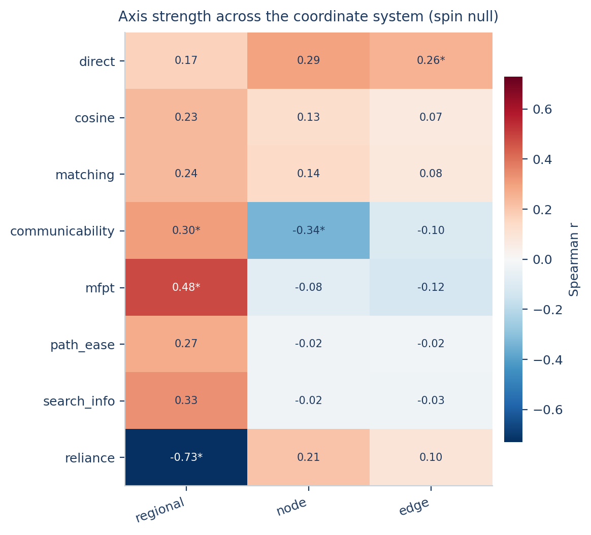

# SFCX — structure–function coupling explorer

**[中文](README.md) | [English](README_EN.md)**

A small toolbox that turns a "readout coordinate system" into executable code.

On the same subjects and the same data, changing the coupling definition, the
dispersion estimator, or the observation scale changes the direction and
strength of the "connectional axis" — this is not data instability, it is an
**unbound coordinate**. SFCX writes the four layers into the API so that every
reported value can be traced back to the coordinate that produced it.

```
definition    →  which structure–function correspondence
pipeline      →  which functional representation
estimator     →  what dispersion is taken over
scale         →  at which granularity it is summarised
```

Two runtimes (Python / MATLAB) implement the same definitions: 27 coupling
definitions, per-subject coupling-value export, variability analysis and batch
import are all included; the MATLAB side ships cross-runtime numerical parity
tests.

---

## Online demo

No installation needed — open in a browser (one isolated session per visitor;
the public instance does not accept custom coupling functions):

> **Live instance**: <https://sfcx-coupling.app.workbuddy.host/?sharecode=K2NICIDQEM>
> (The demo instance may be replaced or retired at any time; for long-term use,
> deploy locally.) Uploaded session data live in a cloud sandbox and are cleared
> on restart — **do not upload sensitive data**.

## Repository layout

```
sfcx/                  Python package (analysis engine, web service, single-page front end)
  web/index.html       Web UI (zero-dependency, driven by the stdlib http.server)
matlab/+sfcx/          MATLAB toolbox (same definitions + uifigure App)
  tests/               numerical parity tests (run_tests.m / run_gui_tests.m)
examples/              5-subject teaching dataset + quickstart scripts
tests/                 Python smoke tests (pytest optional; selftest.py needs nothing)
docs/                  paper Methods draft section, real-data ingestion notes
启动Web界面.bat / SFCX网页版-启动.vbs   local web launchers (double-click)
启动MATLAB界面.bat                      MATLAB App launcher
```

---

## Double-click start (both versions)

Four launchers live in the repository root — **double-click, no command line**:

| Launcher | What it does | Notes |
|---|---|---|
| `SFCX网页版-启动.vbs` | **Recommended.** Silently starts the server and opens the browser — **no console window**; if already running, just opens the browser | Closing the browser does not stop the server; use the next one to stop |
| `SFCX网页版-停止.vbs` | Stops the background server | Confirmation dialog included |
| `启动Web界面.bat` | Legacy console launcher (close the window to stop) | Use when you want live logs |
| `启动MATLAB界面.bat` | MATLAB App (`sfcx.app`) | Edit the MATLAB path inside the .bat |

The VBS launcher probes for a Python with numpy/scipy/matplotlib (`python` →
`py`); on failure it shows the log tail (`sfcx_web_log.txt`). The server binds
to `127.0.0.1:8765`, local machine only. You can send a desktop shortcut of the
VBS to yourself for one-double-click access.

### Public deployment (anyone with a browser)

The server supports internet deployment: `--public` gives **one isolated
session per visitor** (cookie `sfcx_sid`; uploads and results never cross
visitors) and **disables custom-code execution**; it reads the `PORT`
environment variable and binds 0.0.0.0:

```bash
pip install -r requirements.txt
PORT=3000 python -m sfcx.webapp --public
```

Never upload sensitive or unpublished data to a public instance; session data
live in the sandbox and are cleared on restart. The local and online versions
are functionally identical (the online one cannot paste custom coupling
functions).

### Multi-subject batch import (web)

Three equivalent ways:

1. **Multi-file stacking (recommended)** — in the SC / FC / BOLD slot, select
   several same-shape files at once (e.g. 20 `subNN.csv`), or drop several
   files onto a single slot; they are uploaded one by one and stacked into
   N×P×P, and the slot shows `batch_N_subjects.npy · N subjects`;
2. **A single 3-D file** — one .npy / .npz / .mat already containing N×P×P
   (or N×P×T);
3. **The demo data** — the built-in demo is exactly this form.

Shape mismatches fail immediately (bilingual error); a batch of fewer than two
files is rejected. The MATLAB equivalent is the batch mode "folder (one file
per subject)" (`sfcx.batchStack`).

Command-line equivalent (optional):

```bash
python -m sfcx.webapp --port 8765 --open     # web UI
```

```matlab
addpath('...\sfcx_toolbox\matlab'); sfcx.app % MATLAB App
```

## Installation (optional, for command-line users)

```bash
cd sfcx_toolbox
pip install -e .
```

Dependencies: `numpy` `scipy` `matplotlib`. Optional: `pandas`,
`scikit-learn`, `pyyaml`.

## 30-second tour

```bash
sfcx demo --out ./sfcx_demo
```

Generates a synthetic cohort → runs a default route → sweeps the coordinate
matrix → writes a self-contained HTML report (~3 s for 400 subjects × 200
regions). Outputs land in `sfcx_demo/` (`route/results.json`, `route/figures`,
`route/tables`, `route/report.html`, `sweep/axis_r.csv`,
`sweep/figures/coordinate_matrix.png`).

## 5-subject teaching dataset

To walk all three entry points with a small but complete dataset, use
`examples/data/`:

| File | Purpose |
|---|---|
| `demo5_group.npz` | everything in one file (SC / FC / BOLD / networks / hierarchy / coords / behaviour / covariates) |
| `demo5_group.mat` | same, for MATLAB |
| `sub-0X_*.csv` | single-subject matrices for slot-by-slot upload |
| `demo5_expected.json` | reference results to verify the import |
| `README.md` | field descriptions, import steps, reference numbers, construction logic |

```bash
python examples/make_example_data.py      # regenerate (fixed seed)
python examples/verify_example_data.py    # verify and refresh demo5_expected.json
```

Scale: 5 subjects × 64 regions × 120 time points, SC density 24.6 %. BOLD and
the stored FC are exactly consistent (reconstructing FC from BOLD gives
difference 0). Reference results: communicability regional axis r = +0.50
(p = 0.002), direct regional r = +0.33 (p = 0.050), reliance regional r = +0.49
but edge-level r = +0.01 — same data, same axis, different estimator, different
conclusion. That is exactly what this toolbox is about.

## What the synthetic cohort shows

Same 400 subjects, same hierarchy axis, same spin null model — only the
coordinate changes:

| Result | Value |
|---|---|
| Regional axis (communicability) | r = +0.30, spin p = 0.016 |
| After controlling coupling magnitude | r = +0.34, p = 0.008 (rises, not falls) |
| Within vs between networks | 0.866 vs 0.351, Δ = +0.515, p = 0.002 |
| Split-half | r = 0.998 |
| Foci (6 here) | zero internal adjacency, z = −1.20 |
| Individual deviation-spectrum slope | edge r = +0.28 (p = 8×10⁻⁹); network r = +0.08 (p = 0.09) |
| **Axis range across the coordinate matrix** | **−0.73 to +0.48** |

The last row is the reason this toolbox exists: **on one dataset, "the axis"
can be strongly positive, strongly negative, or near zero.**



## Three entry points

One analysis engine, three front ends: web UI, MATLAB toolbox, and the Python
API / command line. Definitions, dispersion estimation, null models and axis
statistics are implemented once per runtime, with cross-runtime parity tests
on the MATLAB side.

### 1. Web UI

The interface is organised as Data → Method → Run → Results:

- **Data**: drop files on the top dropzone or onto a single slot. Supports
  `.npy/.npz/.mat/.csv/.tsv/.txt`; a `.npz/.mat` containing `sc`/`fc`/`bold`
  keys fills all matching slots, bare matrices are routed by name and shape.
  BOLD is converted to FC edge vectors under the chosen pipeline (`pearson` /
  `precision`). Annotations (networks, hierarchy, coords, behaviour,
  covariates) are optional.
- **Method**: pick the primary definition, tick the definitions to compute,
  choose estimators (regional / node-projected / edge), null model
  (`auto`/`spin`/`msr`/`permutation`), permutations and state label.
- **Analysis mode (choose one)**:
  - **Variability analysis** (default): everything above; needs **≥2
    subjects** (below 8 the results are demo-grade);
  - **Coupling values**: skips all dispersion statistics and nulls and outputs
    per-subject coupling values — **works with a single subject**; downloads
    include `coupling_values.npz` and per-subject CSV bundles.
- **Custom**: paste a function; it is statically validated and trial-run
  before registration.
- **Results**: axis table (r / p / n / null), variability profiles, within vs
  between layers, epicentres, the definition × estimator coordinate matrix;
  CSV, PNG and HTML report downloads.
- **Language**: `EN / 中文` toggle in the header; the choice is remembered.

The server uses only the Python standard library (`http.server`); analyses run
in a worker thread while the page polls progress.

### 2. MATLAB toolbox

```matlab
addpath('...\sfcx_toolbox\matlab')
sfcx.app
```

`sfcx.app` is a four-tab interface (① Data → ② Variability → ③ Coupling
values → ④ Log) with **single-subject** and **multi-subject batch** import
modes (a folder with one file per subject, or one .mat with 3-D arrays /
cells); tab ③ computes and exports coupling values for a single subject
(CSV + MAT). See `matlab/README.md`.

Headless calls mirror the Python names:

```matlab
coh = sfcx.buildCohort(struct('sc', sc, 'fc', fc, 'networks', net, ...
                              'hierarchy', hier, 'coords', xyz));
b   = sfcx.analyze(coh, {'communicability', 'direct'}, ...
                   'estimators', {'regional', 'node', 'edge'}, 'nPerm', 500);
b.sweep.r          % axis r, definition x estimator
b.tables.axis_r    % the same matrix as CSV text

vals = sfcx.couplingValues(coh, {'direct'});       % single subject works too
sfcx.exportCouplingValues(vals, outdir, {'csv','mat'});
```

Numerical parity is enforced by `matlab/tests/run_tests.m` against
`matlab/tests/reference.mat` (generated on the Python side): of the 12 fast
definitions × 3 estimators, 33 cells are compared cell by cell (10 definitions
agree to |Δr| ≤ 5e-7; reliance carries a 5e-2 tolerance); `search_info` is
excluded because shortest-path ties resolve differently across runtimes. See
`matlab/README.md`.

### 3. Command line / Python API

```bash
sfcx describe                          # print the four-layer coordinate system and presets
sfcx demo   --out DIR [--subjects 400] [--nodes 200] [--perm 500]
sfcx run    --npz cohort.npz --preset default --out DIR
sfcx run    --npz cohort.npz --metric direct --estimator edge --out DIR
sfcx sweep  --npz cohort.npz --out DIR
```

Presets: `default` (regional), `edge-signal` (edge-level individual signal),
`node-contrast` (same data, different estimator), `precision-fingerprint`
(precision pipeline).

## Python API

```python
import sfcx
from sfcx import Cohort, Coordinate

coh = Cohort.from_npz("cohort.npz")

res = sfcx.run(coh, Coordinate(metric="communicability",
                               pipeline="pearson",
                               estimator="regional",
                               scale="regional"),
               outdir="out", n_perm=1000)

print(res["axis"])          # {'r': ..., 'p': ..., 'null': 'spin'}
print(res["layers"])        # within / between / delta / p
print(res["epicentres"])    # focal regions, separation z
print(res["individual"])    # slope at four scales
```

Coordinates are a frozen dataclass — a wrong layer raises immediately:

```python
Coordinate(estimator="regional")            # ok
Coordinate(estimator="region")              # CoordinateError: unknown estimator
Coordinate.from_preset("default").with_(scale="edge")
```

## Custom coupling functions

Both runtimes accept custom definitions with the fixed signature
`couple(sc, fc, iu, iv, n_nodes)`:

- `sc`, `fc`: `(N, E)`, upper-triangle order matching `iu/iv`
- return `(N, E)` / `(E,)` / `(N, P)` / `(P,)` / `(P, P)` or a scalar; the
  output kind is inferred from the shape

Python:

```python
from sfcx import register_custom, dry_run, list_custom

SRC = """
def couple(sc, fc, iu, iv, n_nodes):
    return sc * fc
"""

dry_run(SRC, n_subjects=8, n_nodes=24)   # trial run only
register_custom("my_coupling", SRC)      # AST whitelist + trial run, then registered
list_custom()
```

MATLAB:

```matlab
src = sprintf('function out = couple(sc, fc, iu, iv, nNodes)\n    out = sc .* fc;\nend\n');
sfcx.registerCustom('my_coupling', src, 'elementwise product');
sfcx.coupling(coh, 'my_coupling');
```

Registered names behave exactly like built-in definitions and can enter batch
analyses, sweeps and exports.

**Security model**: the Python side parses user code against an AST whitelist —
`import`, file/network access and underscore attributes are refused, and the
namespace exposes only `np`, `zscore_edges`, `mat_to_vec`, `vec_to_mat`,
`upper_tri_index`; MATLAB writes the source to a temporary `.m` and trial-runs
it before registration.

## Data format

One `.npz` containing:

| Key | Shape | Meaning |
|---|---|---|
| `sc` | (N, E) | structural connectivity, upper triangle |
| `fc` | (N, E) | functional connectivity, same order |
| `iu_i`, `iv_j` | (E,) | edge endpoints |
| `networks` | (P,) | network label per region (Yeo-7 etc.) |
| `hierarchy` | (P,) | cortical hierarchy position, low = unimodal |

Optional: `coords` (P,3) spherical coordinates (enables the spin null),
`behaviour` (N,), `covariates` (N,k). `E` must equal `P(P-1)/2`; `P` is
inferred from `iu/iv`.

```python
from sfcx import Cohort, demo
coh = demo.make_cohort(n_subjects=400, n_nodes=200)
demo.write_npz("demo_cohort.npz", coh)
```

### BOLD time series also work

| Shape | Meaning |
|---|---|
| `(P, T)` | one subject |
| `(N, P, T)` | many subjects |

The `pearson` pipeline correlates the upper-triangle edges directly; the
`precision` pipeline takes partial correlations after Ledoit-Wolf shrinkage.
Missing samples are linearly interpolated along time.

```python
from sfcx import build_cohort
coh = build_cohort({"bold": bold, "sc": sc, "networks": net, "hierarchy": hier},
                   fc_kind="pearson")
```

The web and MATLAB "BOLD series" inputs use the same path.

## Null models: a p-value means nothing without one

| Null | Needs | When to use |
|---|---|---|
| `spin` | `coords` | preferred with spherical coordinates; preserves spatial autocorrelation |
| `msr` | nothing | Moran spectral randomisation (eigenvector sign-flip approximation); default without coordinates |
| `permutation` | nothing | smoke tests only; **does not preserve spatial autocorrelation — p is anti-conservative** |

The report footer states which null was used. **Reporting p without the null
is reporting nothing.**

## Three analysis routes

| Route | Coordinate | Question |
|---|---|---|
| Topography | estimator=regional, scale=regional | where variability sits, whether it follows the hierarchy, where the foci are |
| Individual signal | estimator=edge, scale=edge | does the deviation-spectrum slope carry behaviour, and at which scale |
| Separability | estimator=node + FC control | does the SFC residual still follow the hierarchy after FC variability is removed |

## Honest boundaries

- **Post-processing only**: inputs are ready-made SC/FC edge vectors or BOLD
  series; no registration, denoising or tractography.
- **Minimum cohort**: dispersion-type statistics (dispersion, axis, layers,
  reliability, individual signal) need **≥2 subjects** — a single subject has
  no inter-individual differences and the SD is undefined; the UI explains
  this and points to the coupling-values mode, which has **no such limit**.
  Below 8 subjects, results are demo-grade.
- **27 definitions in two tiers**: 12 "fast" definitions take part in the
  coordinate sweep by default; 15 "slow" ones (hybrids, Granger, transfer
  entropy, information geometry, RNC/TRR, ...) are fully usable but computed
  per subject and only run when explicitly selected — the `cost` field in
  `catalog()` marks the tier.
- **BOLD-dependent definitions** (reliance family, Granger, transfer entropy,
  RNC, TRR) fail loudly on cohorts without time series instead of returning
  meaningless numbers.
- **Foci depend on the adjacency graph**: the sparser the structural
  connectivity, the more local maxima; a dense graph leaves one global maximum.
- **`msr` is an eigenvector sign-flip approximation**, not the full
  Wagner & Dray MSR.
- **Cross-runtime parity**: 10 of the 12 fast definitions match MATLAB cell by
  cell (|Δr| ≤ 5e-7); `search_info` is excluded (shortest-path ties resolve
  differently across runtimes); the `reliance` edge readout carries ~1e-2
  accumulated float differences (tolerance 5e-2).
- The synthetic data demonstrate coordinate dependence; they do **not** model
  every statistical property of real brain networks.

## Relation to the paper

The toolbox implements the four-layer readout and the three analysis routes of
the paper's Methods; `sweep` reproduces the "the axis flips with the estimator"
figure. The 1,021 + 876 real-cohort results were produced by project scripts
and can be recomputed from the same `.npz` interface.

## Changelog

See [CHANGELOG.md](CHANGELOG.md).

## Running the tests

```bash
python tests/selftest.py          # dependency-free smoke tests (8)
pytest tests/ -q                  # optional pytest suite
```

```matlab
cd matlab/tests; run('run_tests.m')     % core 9 (incl. cross-runtime parity)
run_gui_tests                           % GUI + batch import + export (6)
```

## Citation

If SFCX helps your work, please cite this repository (see
[CITATION.cff](CITATION.cff)).

## License

MIT — see [LICENSE](LICENSE).
